# AWML

Agentic work today is tangled up in the tools that run it, so it's hard to say what a workflow does, who may see each part of it, or how to change one piece without rebuilding the rest. AWML, the Agentic Workflow Modelling Language, describes a workflow in a small YAML file, apart from those tools, and draws it as a diagram through two lenses: who may see each part, and where each part runs. That lets you audit where content crosses to a wider audience, improve one step at a time, move a part to a better platform, and optimise the patterns that recur.

The file lists the workflow's triggers, the steps that pass work along, the notes they read, and the surfaces and outside actions it ends in. AWML draws it with Mermaid, on the shapes of a UML activity diagram, and gives each step a colour and an emoji so you can see at a glance whether AI, code or a person decides it. A drawing runs nothing and grants nothing: it's the description a live system is checked against.


A fictional family's dinners. On Thursday evening AI plans next week's dinners and posts the plan in the family chat. On Saturday code fills the supermarket basket, and checking out waits for a parent's yes to the exact basket. Every morning code checks the joint account against the bills expected, which only the parents see. The thick line is the meal plan moving out to a wider scope, so the carers can see it on the kitchen screen. The comment is a gap that drawing it found: nothing keeps that screen current.

[`SPEC.md`](SPEC.md) is the short, exact definition, and wherever it and this README differ, the spec is right.

## Contents

- [Install](#install)
- [Use it with Claude or ChatGPT](#use-it-with-claude-or-chatgpt)
- [Why AWML](#why-awml)
- [Drawing your own workflows](#drawing-your-own-workflows)
- [Three layers, for one consultant](#three-layers-for-one-consultant)
- [Reading a drawing](#reading-a-drawing)
- [Operations](#operations)
- [Two lenses on one workflow](#two-lenses-on-one-workflow)
- [The security view](#the-security-view-who-may-see-each-part)
- [Connectors](#connectors)
- [The platform view](#the-platform-view-where-each-part-runs)
- [Tiers and yeses](#tiers-and-yeses)
- [Standing approvals](#standing-approvals)
- [Records](#records)
- [The red line](#the-red-line)
- [A tour of the gallery](#a-tour-of-the-gallery)
- [Improving one step at a time](#improving-one-step-at-a-time)
- [What AWML is not](#what-awml-is-not)
- [Using awml](#using-awml)
- [What comes next](#what-comes-next)
- [Status and licence](#status-and-licence)

## Install

```sh
go install github.com/chrismdp/awml/cmd/awml@latest
```

This needs Go 1.22 or later, and puts `awml` in Go's own folder for commands, usually `~/go/bin`. Or download a binary for Linux, macOS or Windows from the [Releases page](https://github.com/chrismdp/awml/releases), unpack it and put `awml` on your path. [Using awml](#using-awml) covers the commands and the file format.

## Use it with Claude or ChatGPT

This repository is also a plugin with one skill, `awml`. The skill helps an AI assistant work out a workflow with you, write both views of it, check them and draw them.

- **Claude Code:** run `/plugin marketplace add chrismdp/awml`, then `/plugin install awml@awml`. Then ask Claude to draw a workflow, or type `/awml:awml`.
- **claude.ai and the Claude desktop app:** download `awml-skill.zip` from the [Releases page](https://github.com/chrismdp/awml/releases). Go to **Customize > Skills**, click **+**, then **Create skill**, then **Upload a skill**, and choose the zip. Skills need a Pro, Max, Team or Enterprise plan, with **Code execution and file creation** turned on in **Settings > Capabilities**. You can instead add the plugin in **Customize > Plugins**, under **Add > Add marketplace**, with `chrismdp/awml`.
- **Codex:** run `codex plugin marketplace add chrismdp/awml`, then `codex plugin add awml@awml`, or install it from `/plugins` in the Codex CLI. Start a new session to use it.
- **ChatGPT:** a workspace owner or admin can add the plugin for their workspace. In the Admin console, open **Plugins**, choose **Add**, then **Import marketplace**, and enter `https://github.com/chrismdp/awml`. OpenAI's help pages describe no way to add it to a single account.

## Why AWML

Any AI system that does work has three layers:

- **The operating model:** what the work is and how it's organised.
- **The workflow:** the steps the work goes through, driven by the operating model.
- **The platforms:** the AI systems, harnesses, models and programs that carry out the work.

AWML describes the middle layer.

AWML has no notion of an agent: an AI might act as one, depending on the platform, but the word isn't precise enough to describe a workflow. Each step says who decides it instead: AI, code or a person.

Drawing a workflow gives you:

- **Auditing:** where content moves to a wider scope or across tools, and how much of the work is automated.
- **Hill climbing:** each step can be scored and improved on its own, as [Improving one step at a time](#improving-one-step-at-a-time) shows.
- **Portability:** the workflow stays the same when a platform changes, so each part can move to the best platform.
- **Efficiency:** the same patterns of steps turn up again and again, so each can be optimised once.

The thinking behind AWML is in [You Must Draw Your AI Workflow to Control It](https://www.chrismdp.com/awml/).

## Drawing your own workflows

If you already run AI routines, such as scheduled tasks, bots and automations, [`GUIDE.md`](GUIDE.md) turns them into AWML files, one workflow at a time. You trace real runs from their records, draw what the design allows, and mark in red what the runs did beyond it. The `awml` skill follows the same guide to find and trace a workflow you already run.

## Three layers, for one consultant

Take a fictional consultant who answers clients' email:

- **Operating model:** every client engagement is a project, and anything that goes out in the consultant's name waits for the consultant's yes.
- **Workflow:** each weekday morning the inbox is brought in, and a client's email updates the engagement's project. A reply is drafted, and the consultant edits it and sends it.
- **Platforms:** Claude Cowork on a Mac mini, Markdown notes synced to the laptop and the Mac mini, Gmail, and the consultant's phone. Any of these can change.

The operating model has little to do with AI: it's how work is organised, whoever or whatever does it. The platforms each work with AI in their own way, slowly converging but with no standard yet, and much of what they run isn't AI at all: code that sorts receipts needs no model. A platform's incentive is lock-in, so the description of the work tends to end up in the platform's own format, where only it can read it. AWML keeps the workflow in a plain file of its own, so the platforms can change around it.

## Reading a drawing

### The parts


Each shape means what it means in a UML activity diagram, so anyone who reads those can read these.

- A **trigger** is a pink pill. It starts the workflow: a time, such as `Weekdays 07:00`, or an event, such as someone asking in a chat or an email arriving. In UML it's an accept time event or an accept event.
- A **step** is a rounded box: one piece of work, with the colour and emoji of who decides it. In UML it's an action.
- A **review** is an amber rounded box, like a step, with `👤 ✅ review` above its label: a person's yes to exact content before it goes ahead. Its one way out is a line with the guard `[yes]`, so in UML it's an action, not a decision node.
- A **fork** is a black bar, where work splits to run side by side. In UML it's a fork node.
- A **context** is a pale blue cylinder: the notes a step may read or write, kept as one folder. In UML it's a data store node.
- A **connector** is a grey hexagon: someone's access to an outside service, such as a calendar, a mailbox or a bank account.
- A **surface** is a white window box: where people meet the system's work, such as a chat, a list on their phone or a screen on a wall.
- An **outside action** is a coral flag: something that changes the world outside the system, such as sending an email or paying a bill. Its label ends with its [tier](#tiers-and-yeses), such as `Send the reply: Ask`. In UML it's a send signal action.
- A **comment** is a dashed box with a cut corner. It points out a gap, or gives an example of what a part could carry, and is tied to what it explains. In UML it's a comment.

UML has nothing for a connector or a surface, so those two shapes are AWML's own. Posting on a shared surface to the people it serves is delivery, not an outside action, so a family chat needs no flag and no review.

### Who decides each step

Read a step's colour and emoji first, because they tell you what kind of thing you're trusting. The emoji says what the colour says, for anyone who can't tell the colours apart and on a page printed without them.

| Colour | Emoji | Who decides | What that means |
|---|---|---|---|
| Green | ⚙️ | Code | It does the same thing every time. It costs almost nothing to run, and you can test it once and rely on it. |
| Blue | 🤖 | AI | A judgement call that can be wrong in new ways, so it needs inspecting and improving, and its output is worth scoring. |
| Amber | 👤 | A person | The slowest step of all, and the one that needs someone to be there. Keep it for where it matters, such as a yes to something that can't be undone. |

A workflow whose every step is green ⚙️ has no AI in it, even if AI helped build it.

### The lines

| Line | Drawn as | Means |
|---|---|---|
| `start` | A dotted arrow | Starts something, as a trigger starts a step |
| `data` | A solid arrow | Moves data from one part to the next |
| `publish` | A thick arrow | Moves content into a wider scope, which is publishing |
| `refused` | A line ending in a cross | A read the design refuses |
| `tie` | A dotted line | Links a comment to what it explains |
| `hidden` | Nothing | Steers the layout only |

A line may carry a label. Words in square brackets are a **guard**, the condition the line is taken on, as in UML. A line drawn red is a finding: see [The red line](#the-red-line).

## Operations

Besides who decides it, a step may name its **operation**, the kind of work it does. The two are separate: AI can sort or draft, and so can a person. The drawing shows both in small grey type above the step's label, who decides first and then the operation, as in `🤖 ✏️ draft` for a draft AI writes. Naming an operation is optional, and a step without one shows only who decides it.


| | Operation | `op` | It answers | It produces | It must never |
|---|---|---|---|---|---|
| 📥 | Bring in | `bring-in` | What's new? | The input as it really is, such as an email, a transcript or a calendar, made readable | Decide where it goes |
| 🗂️ | Sort | `sort` | Where does this belong? | A place for it, or none with the reason | Change anything outside the system |
| 🧠 | Learn | `learn` | What does this teach us? | New notes, or more in old ones, and rules taken from corrections | Act in the world |
| 📋 | Prepare | `prepare` | What's needed before this? | A brief for a named moment, such as a meeting | Decide for a person |
| 🔍 | Check | `check` | Is anything wrong or missing? | A verdict | Change anything |
| 🪞 | Reflect | `reflect` | Is time going where it should? | Evidence and questions for the people who set the aims | Make up an aim |
| ✏️ | Draft | `draft` | What should be said? | A draft | Send it or publish it |
| 🛠️ | Do | `do` | What should change, in the world or in a piece of work? | The change, within its tier | Act without the yes its tier needs, or replace something without keeping what was there |
| 💬 | Answer | `answer` | What do we know about this? | An answer from the notes, naming them | Act, or change a note |
| ❔ | Other | `other` | Work that fits none of the nine | Whatever it is for | Nothing AWML checks |

A drawing can show some of these limits, and `awml check` holds every step to them:

- **Only a `do` step leads to an outside action**, by a line straight to it or through a review or a fork. A draft step never leads to an outside action, even through a review: a draft goes to a `do` step that asks to send it, or to a person's own `do` step.
- **An `answer` step and a `check` step never write to a context.** They read contexts, and speak on surfaces.
- **An `op` names one of the ten,** and only a step names one.

A line leads somewhere when it starts something, moves data or publishes. A hidden line, a refused read and a tie lead nowhere. A step marked `other`, or with no `op` at all, is held to none of these rules.

The other limits, such as never deciding for a person, are about what happens inside a step, which no drawing shows, so the people who read it judge them.

When a rule is broken, `awml check` says which step and why:

```
part "write" leads to outside action "send", but its op is draft: only a do step leads to an outside action
part "answer" writes to context "notes", but its op is answer: an answer step never writes to a context
part "due" has unknown op "chek"
```

## Two lenses on one workflow

Every workflow raises two questions, and a drawing that answers one hides the other, so each gets its own view:

- **The security view** (`view: security`): who may see each part, and where content crosses from one group of people to a wider one.
- **The platform view** (`view: platform`): where each part runs, and how the platforms fit together.

The parts and lines are the same in both, and only the boxes around them change. Draw both, one file for each, and read them side by side.

The consultant's email, through both lenses:

<table>
<tr><th>The security view</th><th>The platform view</th></tr>
<tr>
<td valign="top"></td>
<td valign="top"></td>
</tr>
</table>

The security view has two scopes side by side: the consultant's private scope, and the business, which the consultant shares with an associate. Two thick lines cross between them, and each is publishing, for a different reason. A standing rule lets a client's email into the business, which adds a viewer, the associate. The consultant takes the reply back into the private scope by editing it and sending it, which loosens the terms: the business keeps client work under the engagement's confidentiality terms, and the consultant's own mailbox doesn't carry them.

The platform view spreads the same twelve parts over four platforms, with the edit on the consultant's phone. That's how most agentic work is put together today: no single tool can yet run a whole workflow, so most of us join several. Wherever the flow crosses from one platform to another, it needs the right connector in place, or someone has to copy and paste. Moving the notes into a notes service, or the scheduled task from Claude Cowork to a managed agent service, moves those parts to other blocks and changes nothing else. Swapping the model moves no part at all.

## The security view: who may see each part

A **scope** is a set of people. Everything in a workflow belongs to one scope, which says who may see it and which companies may process it: the makers of the models the system uses, and services such as transcription or the host of a folder. A scope's terms say whether a company may keep the content, and a company that may train on it is never used at all. A scope may also allow no processing, as for something told in confidence.

In the security view, each scope is a dashed box, labelled with its name and members, such as `family: parents, kids`. A box around another can name only the people it adds, with `+`, as in `carers: + June, Beth` around the family's box.

### Where each part sits

- A **context** sits in the box of its scope.
- A **step** sits in the box of the scope it writes into, with the reviews and outside actions it leads to.
- A **connector** sits in the box of the scope its inputs take, so a connector only the parents may use sits in the parents' box, and nothing outside that box can read through it.
- A **surface** sits in the box of the scope its viewers make up.

### Boxes inside boxes, and side by side

One box sits inside another only where every member of the inner scope is in the outer one. A family's scopes often nest: the parents' box sits inside the family's, which sits inside the box of the family and its carers.

Scopes aren't a ladder, though. Two may overlap, each with someone the other lacks, and then their boxes sit side by side. Boxes also sit side by side when one scope's people are all in the other but its terms are looser, as with the consultant's private scope beside the business in [the client email](#two-lenses-on-one-workflow).


Here Jo keeps the books for a bakery and runs a pottery shop. The two scopes share only Jo, so neither box goes inside the other, and any line between them, such as this checklist, is publishing.

### Reading across scopes

A step reads from its own scope or a wider one, since everyone in a scope may see what a wider scope holds. A read from a narrower scope is one the design refuses, drawn as a line ending in a cross. In the family's question below, the answer may use the family's notes and the carers' notes, but never one person's own notes, even when that person is the one asking.


### Publishing

Content moves between scopes in only two ways.

- A move **narrows** when every member of the target scope is in the source, and the target's terms are at least as strict. Narrowing is routing: it shows content to fewer people, or to the same people more carefully, so it's drawn as an ordinary line.
- Any other move adds a viewer or loosens the terms. That's **publishing**, drawn as a thick line so you notice it first.

Publishing waits for a person's yes, unless a **standing rule** names that target for that kind of item, and then the thick line's label names the rule, as in `standing rule: dinners to carers`. Only the item crosses, never what lies behind it. Nothing reaches the public without a person's yes to that item, under any rule or approval.

## Connectors

A **connector** is access to one outside service through one credential: a person's, one an outside party lends, or the system's own. The design names whose access each connector is, which service it reaches and what it may do, such as read, post or carry an outside action, and its label says whose it is, as in `Owen's supermarket account`.

Whose access it is matters, because a connector speaks with that access.

- **A person's connector** reaches only what that person can, and speaks in their name, so they, or a role they choose, approve what it sends. It stops when they leave, so work that must outlive them shouldn't rest on one.
- **The system's own connector**, such as a service account, often reaches more than any one person. So each item it brings in takes the scope of who could see it where it came from, never everyone's.

## The platform view: where each part runs

In the platform view, each platform is a tinted block, and each part sits in the block of the platform it runs on or lives in. A **platform** is a machine or service that brings its own surfaces, its own **harness** (the program that runs each step and calls a model) and its own models, and often its own triggers: Claude Cowork on a Mac mini, a mail service or a phone. So a trigger sits in the block of the platform that fires it, and a model on its own isn't a platform: it's a choice a platform makes. A **machine** is anywhere the system's tools run that shares one set of access: a server, a laptop, or a sandbox on either.


A block is labelled with what an **implementation** chose there, such as the model it runs, and with when the machine is on, if that isn't always, as in `Noor's laptop: on some evenings`. Work for a machine that is off waits for it. An implementation is one running system built from a design, and each draws its own platform view, with the same parts in different blocks.

Two rules make this view worth drawing.

- **Anything running on a machine can reach everything that machine holds, and send it to any host the machine can reach.** So a machine holds only contexts and connectors whose scopes allow every company that processes content there, and reaches only the hosts its connectors need.
- **An implementation's choices change how a step is done, never what it may do.** The contexts a step reads, the tier of each action it takes and its review stay the design's call. A different model may mean a different company processing the content, and every context feeding the step must allow that company.

## Tiers and yeses

Every outside action has a **tier**.

| Tier | When it applies | Drawn as |
|---|---|---|
| **Allow** | The action can be undone when it's taken, is seen only within its scope, and stays within the design's spending limits: a note, a draft, a label, an entry in a person's own calendar | A flag a step leads to directly: it just happens |
| **Ask** | Any other action that isn't blocked, and any the design marks Ask because the person who answers for it would be surprised | A flag with a review on the way to it, or one a person's own `do` step leads straight to: it waits for a yes, unless a standing approval covers it |
| **Block** | Never, whatever anyone says | Never a line. A flag with nothing leading to it may name it, and a line into one is red |

A **yes** is an approver's yes to one action and its exact content, shown with what it's for: the work it serves, why now, what started it and what it drew on. A yes to "send the reply" in general is no yes at all. Any change to the content after the yes, a fix included, needs a new yes.

A person's own `do` step is their yes: when the consultant edits the reply and sends it, they've said yes to its exact content. So an Ask action reached straight from one needs no review in front of it.

An **approver** is a role, such as the approver of sends, held by one or more people. A rare, high-stakes kind of action may need a yes from two approvers, two people in two roles, to the same content, drawn as two reviews in a row. Every such action waits on both, so it's kept for few kinds.

## Standing approvals

Asking for a yes to every small, reversible action soon trains people to say yes without looking. A **standing approval** is the way out. The person who answers for a scheduled task approves it once to take named kinds of action that can be undone, within limits such as how many and how often, so each item doesn't wait for a yes. Each action under it is recorded and listed for that person, with how to undo it. One that acts in someone else's name needs their yes too, and ends when their access does. Nothing that can't be undone goes this way, such as a send to a person or a payment, and nothing that reaches the public.

A standing approval is drawn on the outside action it covers: the label names it, and a comment tied to the flag gives its kinds and limits. The file format needs no field of its own for one.


Here Sam approved the morning renewals once, for renewals only and up to six a week.

## Records

Every step leaves one **record** each time it runs: what started it, what decided it (code, a model with its instructions and exact version, or a person), what it drew on, what it made and what it cost. Records are only ever added to, and only the system writes them.

A drawing shows what each record should say, never what any record does say, so a record that names other sources, another kind of decider or other work than the drawing shows is a finding. Only the records show whether a step ran, which model version decided it, what it cost and what it really read.

## The red line

Where a live system does something its design doesn't allow, the line for it is drawn red, labelled with what is wrong. A red line is a finding about the live system, not part of the design. It usually comes from the records, set against the drawing.


Here the design waits for Ella's yes to the exact message, but one week the live system sent the draft straight out. `awml check` doesn't hold a red line to the operations' rules or to the boxes it crosses, so the drawing can show exactly what went wrong.

## A tour of the gallery

Each drawing here shows one idea, with fictional people and everyday cases, and their files are in [`examples/tour/`](examples/tour). Several are patterns, and the commonest are the first two: the draft for review and the do step. The rest of the gallery appears beside the idea it draws: [two scopes side by side](#boxes-inside-boxes-and-side-by-side), [operations](#operations), [a standing approval](#standing-approvals) and [a red line](#the-red-line).

### Draft for review

AI drafts the swimming club's Friday message to the parents. A `do` step asks Ella to send it, and the message goes out only after Ella's yes to that exact message. Use it for anything that goes out in someone's name or can't be taken back.


### A do step

A `do` step settles the window cleaner's visit. Putting the next visit in the parents' calendar can be undone, so it's Allow and just happens. Paying is Ask, so it waits for Dev's yes to the exact payment. Use it for any change in the world, or in the state of a piece of work.


### Answer from the notes

Ana asks in the flat's chat when the boiler is serviced. The answer comes from the flat's notes alone, and the cross marks Tom's own notes, which it may not read. Use it wherever someone asks a question on a surface others can see.


### Check by code

Every morning, code matches the joint account against the bills expected, reports anything missing or different in the parents' chat, and changes nothing. Use it for any question code can settle.


### Publish

The week's school pickups are copied into the parents' notes, and the thick line moves them into the wider scope that adds Grandma Rose, under the standing rule it names. Use it whenever something leaves its scope for a wider one.


### A fork

The school's newsletter arrives, and the bar splits the work so two steps take it side by side: one takes the term dates into the family notes, and one looks for anything that needs a reply.


### A step a person does

Code checks what the car needs each month and puts the MOT on Ade's list. Booking it is Ade's own step, so it's amber and marked 👤, and it waits there.


### A gap

Drawing bin day shows what a list of its tasks hides: nothing posts the bin day in the house chat the night before. A comment marks the gap.


### A platform view

The family's photos run on two machines: a server that never stops, and Noor's laptop, which is on only some evenings. The photos wait on the server until the laptop can sort them.


## Improving one step at a time

Once each step is a box with a known input and a known output, you can improve it on its own.

1. Keep a set of past cases for the step: what came in, and what it should have produced.
2. Score the step's output against those cases.
3. Try a change to that step alone: a different prompt, a different model, or code in place of AI.
4. Keep the change only if the score goes up.

Every review is a label for the step before it. Each yes, each no and each edit says how that step is doing, so the workflow gathers its own test cases as it runs. The comments on the family's planning step in the platform view are examples: one says the step is scored against the plans the family kept, and the other that it's tried on a second model some weeks.

This only works if you understand the workflow, and if your platform lets you see and change one step without touching the rest. Most of today's tools don't.

## What AWML is not

AWML isn't a visual workflow tool, where the diagram is the program and drawing a line makes data flow. Every part and line in an AWML drawing is something the design names, so the drawing can be made from the design itself, and then it can't drift from it.

AWML builds on UML's activity diagram rather than BPMN, which covers similar ground, because more engineers already read UML.

## Using awml

### The commands

```sh
awml check examples/question.yaml        # report mistakes; exits 1 on any
awml draw examples/question.yaml         # print the Mermaid
awml page examples/dinners-security.yaml examples/dinners-platform.yaml -o dinners.html
```

- `awml check` reads each file and prints `ok`, or one line for each mistake, and exits 1 if any file has one.
- `awml draw` prints a file's Mermaid. It refuses a file with mistakes, and prints them instead.
- `awml page` writes one standalone HTML page that draws each file with Mermaid in the browser, in the order given. Each file gets its own heading, saying which view it is. The page takes the files' title when they all share one, as the two views of the family's dinners do, and is called Workflows when they don't.

The Mermaid works anywhere that draws Mermaid 11.4.1. To make an SVG, use the Mermaid CLI, which needs Node:

```sh
awml draw my-workflow.yaml > my-workflow.mmd
npx -y @mermaid-js/mermaid-cli@11.4.1 -b white -i my-workflow.mmd -o my-workflow.svg
```

`examples/render.sh` redraws every example this way.

### Writing a file

One file holds one view of one workflow:

```yaml
awml: "0.2"
title: The family's dinners
view: security      # or: platform
groups:
  - { id: carers, label: "carers: + June, Beth" }
  - { id: family, label: "family: parents, kids", in: carers }
parts:
  - { id: thu, kind: trigger, label: "Thursday 19:00" }
  - { id: favourites, kind: context, label: "Favourites and recipes", in: family }
  - { id: plan, kind: ai, label: "Plan next week's dinners", in: family }
  - { id: chat, kind: surface, label: "Family chat", in: family }
lines:
  - { from: thu, to: plan, kind: start }
  - { from: favourites, to: plan, kind: data }
  - { from: plan, to: chat, kind: data, label: posted }
```

- The file needs `awml`, the version `"0.2"`; `title`, the workflow's name; `view`, `security` or `platform`; and `parts`. It may have `groups` and `lines`.
- A **group** is a scope in a security view, or a platform in a platform view. Each has an `id` and a `label`, and may have `in`, the id of the group it sits inside.
- A **part** has an `id`, a `kind` and a `label`, which a fork doesn't need. It may have `in`, the id of its group. A step, `ai`, `code` or `person`, may have `op`, its operation, such as `op: draft`.
- A **line** has `from` and `to`, the ids of two parts, and a `kind`. It may have a `label`, and `breaks: true` to draw it red.
- The part kinds are `trigger`, `ai`, `code`, `person`, `review`, `fork`, `context`, `connector`, `surface`, `outside` and `comment`. The line kinds are `start`, `data`, `publish`, `refused`, `tie` and `hidden`.
- An id is letters, digits and underscores, starting with a letter, and no two are the same.
- Parts are drawn in the order listed, and each group after the parts beside it. A trigger or comment with no `in` is drawn in the group of what it starts or explains. A `hidden` line steers the layout when Mermaid puts something in an awkward place.

Every id, label, kind and reference to an id is text. `awml` reads YAML 1.2, which reads `true`, `false`, numbers and dates such as `2026-10-20` as something other than text, so quote those. Tools that read YAML 1.1 also read `yes`, `no`, `on` and `off` as true or false, and `19:00` as a number, so quoting those too keeps a file the same in every tool. `breaks` is `true` or `false`, unquoted.

### What `awml check` reports

`awml check` reports a missing or unknown field, an unknown kind or view, an id used twice or badly written, a value YAML didn't read as text, a `breaks` that isn't true or false, a part or group in an unknown group, a group nested in itself, a line to or from an unknown part, a comment linked by anything but `tie`, a `tie` with no comment at either end, an unknown `op` or one on a part that isn't a step, a step that does what its operation must never do, as far as the drawing shows it, and a `data` line in the security view that moves content anywhere but its own box or a box inside it, which is publishing drawn as routing. [`SPEC.md`](SPEC.md) gives the exact rules.

### Examples to start from

Besides the gallery, [`examples/`](examples) has three workflows to start from: the family's dinners and the consultant's email, each in both views, and the question in the family chat. It also has [`examples/legend.yaml`](examples/legend.yaml), the key at the top of [Reading a drawing](#reading-a-drawing). The tests run with `go test ./...`, and they check that every example has no mistakes and that its drawings are current.

## What comes next

- **Platforms that conform to AWML.** A platform that can read a workflow file, run it as drawn and report each step's record against it would let people move their work between platforms. Such a platform could also give the guarantees these designs badly need, such as refusing an outside action that no yes released, rather than leaving them to each workflow's author.
- **A plan for each platform.** From an AWML file, generate something like a Terraform plan: a repeatable description of how a workflow fits a particular platform, which that platform can apply. Moving a workflow would then mean applying a different plan, rather than rebuilding it by hand.
- **Evaluations for every step.** A platform could capture evaluations for each step as it runs, and rerun them on different models to find the cheapest one that still does the job well.

## Status and licence

Draft 0.2. The notation and the file format may still change.

MIT. See `LICENSE`.
