# AWML

AWML, the Agentic Workflow Modelling Language, describes agentic work as diagrams. You write a workflow as a small YAML file: its triggers, the steps that pass work along, the notes they read, and the surfaces and outside actions it ends in. AWML draws it with Mermaid, on the shapes of a UML activity diagram, coloured so you can see at a glance whether a model, a rule or a person decides each step. Dashed boxes show who may see each part, and a second view shows where each part runs. A drawing runs nothing and grants nothing: it's the description a live system is checked against, and a red line marks where the system does something the description doesn't allow.


A fictional family's dinners. On Thursday evening a model plans next week's dinners and posts the plan in the family chat. On Saturday a rule fills the supermarket basket, and checking out waits for a parent's yes to the exact basket. Every morning a rule matches the joint account against the bills expected, which only the parents see. The thick line is the meal plan moving out to a wider scope, so the carers can see it on the kitchen screen. The comment is a gap that drawing it found: nothing keeps that screen current. The same workflow, by where each part runs, is [`examples/dinners-where.svg`](examples/dinners-where.svg).

## Install

```sh
go install github.com/chrismdp/awml/cmd/awml@latest
```

This needs Go 1.22 or later, and puts `awml` in Go's own folder for commands, usually `~/go/bin`. Or download a binary for Linux, macOS or Windows from the [Releases page](https://github.com/chrismdp/awml/releases), unpack it and put `awml` on your path.

## A tour

Each of these shows one idea in a small drawing. Their files are in [`examples/tour/`](examples/tour), and [`SPEC.md`](SPEC.md#patterns) names the patterns that come up most.

### A draft, a yes and the send

A model drafts the swimming club's Friday message to the parents. Ella says yes to the exact message, and only then does a `do` step send it: the draft step itself never sends.


### A fork

The school's newsletter arrives, and the bar splits the work so two steps take it side by side: one takes the term dates into the family notes, and one looks for anything that needs a reply.


### A refused read

Ana asks in the flat's chat when the boiler is serviced. The answer comes from the flat's notes alone, and the line ending in a cross is a read the design refuses: Tom's own notes.


### Publishing

The week's school pickups are copied into the parents' notes. The thick line moves them into the wider scope that adds Grandma Rose, which is publishing, so it names the standing rule that allows it.


### Two scopes side by side

Jo keeps the books for a bakery and runs a pottery shop. The two scopes share only Jo, so neither box sits inside the other, and any line from one to the other, such as this checklist, is publishing.


### A red line

The club's Friday message as the live system ran it one week: it sent the draft straight out, without Ella's yes. The red line is a finding about the system, not part of the design.


### A step a person does

A rule checks what the car needs each month and puts the MOT on Ade's list. Booking it is Ade's own step, so it's amber, and it waits on Ade's list.



### A gap

Drawing bin day shows what a list of its tasks hides: nothing posts the bin day in the house chat the night before. A comment marks the gap.


### Where it runs

The family's photos, by where each part runs. The server is always on and Noor's laptop only some evenings, so the photos wait on the server until the laptop is on to sort them.



### Operations

One step in each of four operations: sort, learn, draft and do. Only the `do` step leads to an outside action.


### A do step

A `do` step settles the window cleaner's visit. Putting the next visit in the parents' calendar can be undone, so it's Allow and just happens. Paying is Ask, so it waits for Dev's yes to the exact payment.


### A standing approval

Sam approved the morning renewals once, for renewals only and up to six a week, so each renewal goes without a yes and is listed for Sam with how to undo it.


### Check by rule

Every morning a rule matches the joint account against the bills expected, and reports anything missing or different in the parents' chat. It reads and reports, and changes nothing.



## Writing a file

One file holds one view of one workflow:

```yaml
awml: "0.1"
title: The family's dinners
view: scopes        # or: where
groups:
  - { id: carers, label: "carers: + June, Beth" }
  - { id: family, label: "family: parents, kids", in: carers }
parts:
  - { id: thu, kind: trigger, label: "Thursday 19:00" }
  - { id: favourites, kind: context, label: "Favourites and recipes", in: family }
  - { id: plan, kind: ai, label: "Plan next week's dinners", in: family }
  - { id: chat, kind: surface, label: "Family chat", in: family }
lines:
  - { from: thu, to: plan, kind: start }
  - { from: favourites, to: plan, kind: data }
  - { from: plan, to: chat, kind: data, label: posted }
```

The part kinds are `trigger`, `ai`, `rule`, `human`, `review`, `fork`, `context`, `connector`, `surface`, `outside` and `comment`. The line kinds are `start`, `data`, `publish`, `refused`, `tie` and `hidden`, and `breaks: true` draws a line red. A step may name its operation, such as `op: draft`, which is drawn as `«draft»` above its label, and `awml check` then holds the step to what that operation must not do. A trigger or comment with no `in` is drawn in the group of what it starts or explains. [`SPEC.md`](SPEC.md) gives every field and what each part and line means, [`examples/`](examples) has three workflows to start from, two of them in both views, and [`examples/tour/`](examples/tour) has the drawings above. [`examples/client-email-where.svg`](examples/client-email-where.svg) shows one small workflow running across five platforms, which is how most agentic work is put together today.

## Drawing it

```sh
awml check examples/question.yaml        # report mistakes; exits 1 on any
awml draw examples/question.yaml         # print the Mermaid
awml page examples/dinners-*.yaml -o dinners.html
```

`page` writes one standalone HTML page that draws each file with Mermaid in the browser.

The Mermaid works anywhere that draws Mermaid 11.4.1. To make an SVG, use the Mermaid CLI, which needs Node:

```sh
awml draw my-workflow.yaml > my-workflow.mmd
npx -y @mermaid-js/mermaid-cli@11.4.1 -b white -i my-workflow.mmd -o my-workflow.svg
```

`examples/render.sh` redraws every example this way. The tests run with `go test ./...`.

## Status

Draft 0.1. The notation and the file format may still change.

## Licence

MIT. See `LICENSE`.
