# AWML: the Agentic Workflow Modelling Language

Draft 0.9, 28 October 2026.

AWML describes agentic work as diagrams, written as YAML files and drawn with Mermaid.

**Contents:** [What it describes](#what-it-describes) · [The parts](#the-parts) · [The lines](#the-lines) · [The security view](#the-security-view-who-may-see-each-part) · [Connectors](#connectors) · [The platform view](#the-platform-view-where-each-part-runs) · [Placing a workflow](#placing-a-workflow-where-it-can-run) · [Workflows together](#workflows-together) · [Tiers and yeses](#tiers-and-yeses) · [Standing approvals](#standing-approvals) · [Untrusted text](#untrusted-text-where-strangers-text-reaches) · [Operations](#operations) · [Patterns](#patterns) · [Records](#records) · [The red line](#the-red-line) · [What AWML is not](#what-awml-is-not) · [The file format](#the-file-format)

## What it describes

A **workflow** is the chain from a trigger to the surfaces and outside actions it ends in, through the steps and approvals that pass work along. A **design** is the written description of a system that does such work: who takes part, what each part may read and write, and what needs a person's yes. AWML draws one workflow of a design as one picture, so a person can see who decides each step, who may see each part and what leaves the system.

One canonical file holds the workflow's design and any **implementations**, the choices of where its parts run. Its **security view** groups the parts by who may see them. Each implementation gives a **platform view**, grouping those same parts by where they run. A separate **platform description** says what one platform offers, so a workflow can be matched to the platforms that could run it. AWML builds on the UML activity diagram, so each part means what its UML element means.

## The parts

| Part | `kind` | Drawn as | Colour | UML element |
|---|---|---|---|---|
| Trigger | `trigger` | A pill, with its time if it has one | Pink `#fbe1ee` | Accept event, or accept time event |
| Step decided by AI | `ai` | A rounded box, with 🤖 and its operation above its label | Blue `#cdd3fb` | Action |
| Step decided by code | `code` | A rounded box, with ⚙️ and its operation above its label | Green `#c4e3d1` | Action |
| Step decided by a person | `person` | A rounded box, with 👤 and its operation above its label | Amber `#f7d79a` | Action |
| Review | `review` | A rounded box, with 👤 ✅ review above its label, left by `[yes]` | Amber `#f7d79a` | Action, whose one way out is guarded by `[yes]`, so not a decision node |
| Standing approval | `approval` | A rounded box, with 👤 📜 standing approval above its label | Amber `#f7d79a` | Action, like a review |
| Context | `context` | A cylinder | Pale blue `#e2eef9` | Data store node |
| Connector | `connector` | A hexagon | Grey `#eceef2` | None |
| Surface | `surface` | A window box | White | None |
| Outside action | `outside` | A flag, with its tier | Coral `#fde4dc` | Send signal action |
| Comment | `comment` | A dashed box with a cut corner | White | Comment |

A **trigger** starts a workflow: a time, or an event such as someone asking in a chat. A **step** is one piece of work, drawn with the colour and emoji of who decides it: AI, code (which does the same thing every time) or a person. A **review** is a person's yes to exact content before it goes ahead. A **standing approval** is a person's yes given once, in advance, to each action of named kinds that a scheduled task takes, within limits, in place of a yes to each one. A **context** is the notes a step may read or write, kept as one folder. A **connector** is someone's access to an outside service, such as a calendar or a bank account. A **surface** is where people meet the system's work: a chat, a list on their phone, a screen on a wall. An **outside action** changes something outside the system, and its label ends with its tier. A **comment** marks a gap, or gives an example of what a part could carry.

The emoji say what the colours say, for a reader who can't tell the colours apart and on a page printed without them: 🤖 is AI, ⚙️ code and 👤 a person, on every step, review and standing approval. Code is a gear rather than a computer, because a computer reads as a machine, and machines such as a laptop or a server are what the platform view shows.

UML has nothing for a connector or a surface, so those two shapes are AWML's own.

In either view, a trigger or design comment given no scope or block is drawn beside the part at the other end of its first line that isn't hidden. An implementation may add comments that appear only in its platform view.

## The lines

| `kind` | Drawn as | Means |
|---|---|---|
| `start` | An arrow | Starts something |
| `data` | An arrow, thick where it publishes | Moves data, and publishes where it moves content into a wider scope |
| `refused` | A line ending in a cross | A read the design refuses |
| `tie` | A grey dotted line | Links a comment to what it explains |
| `hidden` | Nothing | Steers the layout only |

A line's style says where it goes, not its kind. A line that reads from or writes to a context, a connector or a surface is dotted: that's information moving in and out. Any other line, such as one from a trigger or from one step to the next, is solid: that's the path the work takes. A line that publishes is thick either way, and a `refused` line keeps its cross.

A line may carry a label. Words in square brackets are a guard, the condition the line is taken on, as in UML: `[yes]` leaves a review. A comment moves nothing, so only `tie` lines link it. A tie has no direction, so whichever way the file writes it, it's drawn from the part to the comment, and the comment hangs below or beside what it explains.

A drawing says what happens, not how a platform schedules it. Several `start` lines out of one part start work that runs side by side. Several `start` lines into one step mean any of them can lead to it. Where the step waits for all of them, its label says so, as in `Once both reviews are done, sort their findings`.

A trigger's **run** is every part reached from it along `start` lines, whatever kind of part each is, so it carries on through steps, reviews and standing approvals alike. A `data` line doesn't carry a run on, even straight from one step to the next: data says what a step reads, and a start line says what runs next. Where work moves on to a step and its content moves into a wider scope, the two are drawn as a `start` line and a `data` line, so the publish still shows. Triggers whose runs share a part start one workflow, as a label and a schedule both starting the same build do. A context, connector or surface that two runs read or write, but neither reaches along start lines, doesn't join them.

So that a drawing can be followed, `awml check` warns of:

- **A file that holds several workflows,** where its triggers fall into more than one group. It names each group's triggers by label. Split the file at its triggers into workflows that refer to each other, as in [Workflows together](#workflows-together). A file with one trigger never warns.
- **A part no trigger reaches,** with no line linking it to any trigger, following lines either way and through any parts, but leaving out comments and their ties. A context that a step reads is linked through that step. Connect the part or remove it.
- **A comment that explains nothing,** with no `tie` to any part. Tie it to what it explains, or remove it.
- **A step that no trigger starts,** which is each step, review or standing approval in no trigger's run, linked to a trigger or not. Either a start line is missing, so the workflow isn't finished, or the step begins work of its own, which belongs in another workflow that an outside action starts.

## The security view: who may see each part

A **scope** is a set of people. Everything belongs to one scope, which says who may see it and which companies may process it: the makers of the models the system uses, and services such as transcription or the host of a folder. Its terms say whether a company may keep the content, and a company that may train on it is never used. A scope may also allow no processing, as for something told in confidence. Its `processing` field names the companies, so `awml fit` can check them (see [Placing a workflow](#placing-a-workflow-where-it-can-run)). Scopes aren't a ladder: two may overlap, each with someone the other lacks, or one may hold only people the other has, under looser terms.

In the security view, each scope is a dashed box, labelled with its name and members, such as `family: parents, kids`, or with `+` and the people it adds to the scope inside it, such as `carers: + June, Beth`.

**Where a part sits.** A context sits in the box of its scope. A step sits in the box of the scope it writes into, with the reviews and outside actions it leads to. A standing approval sits in the box of the scope of the person who gives it. A connector sits in the box of the scope its inputs take. A surface sits in the box of the scope its viewers make up.

**Boxes inside boxes.** One box sits inside another only where every member of the inner scope is in the outer one, and its terms are at least as strict. Otherwise they sit side by side. A family's scopes often nest: the parents' box sits inside the family's, which sits inside the box of the family and its carers. A consultant's client scope and their side venture's share only the consultant, so they sit side by side.

**Reading.** A step reads from its own scope or a wider one, since everyone in a scope may see what a wider scope holds. A read from a narrower scope is one the design refuses, drawn as a line ending in a cross.

**Moving content.** A move **narrows** only when every member of the target scope is in the source and the target's terms are at least as strict. Narrowing is routing, drawn as an ordinary line. Any other move adds a viewer or loosens the terms, which is **publishing**, drawn as a thick line. On the drawing, a move into the box it starts in, or a box inside that one, narrows. A part drawn outside every box counts as wider than any of them. So a `data` line publishes whenever its scopes make it one, and nobody marks it.

`awml draw` adds to the label of each publish what it does, after a `·`: who it adds, such as `adds an associate`, what it loosens, such as `loosens anthropic only to any company`, or both. It reads who a scope holds from its label, with a `+` label holding everyone in the scopes inside it too, and its terms from its `processing`. Where neither says, the label names the scope the content moves into, as in `publishes into pottery`, and a move out of every box says `publishes outside every scope`. A step put in the wrong scope by mistake then shows as a publish, which is what reviewing the drawing is for. In the client email example, the reply's move from the business scope to the consultant's own step adds no one, but its label says `loosens anthropic only to any company`.

Publishing waits for a person's yes, unless a **standing rule** names that target for that kind of item. A standing rule moves only the words of people who agreed to that target, and the line's label names the rule and who they are, as in `co-op notes, under the bakery's rule, for customers who ticked the box`. Only the item crosses, never what lies behind it. Nothing reaches the public without a person's yes to that item, and a standing rule never takes an item public. The one exception is an outside action that is public, under a standing approval whose label says who accepted the risk and on what evidence, as in [Standing approvals](#standing-approvals).

## Connectors

A **connector** is access to one outside service through one credential: a person's, one an outside party lends, or the system's own. The design names whose access each one is, which service it reaches and what it may do, such as read, post or carry an outside action. Its label says whose it is, such as `Owen's supermarket account`.

Lines to a connector follow the data. A read comes out of the connector, and a write, or an outside action carried out through it, goes in. So when a bakery places an order through its supplier account, the line runs from `Place the order: Ask` into the account's connector.

A person's connector reaches only what that person can, and what it sends speaks in their name, so they, or a role they choose, approve what it sends. It stops when they leave, so work that must outlive them shouldn't rest on one. The system's own connector, such as a service account, often reaches more than any one person, so each item it brings in takes the scope of who could see it at its source, never everyone's.

## The platform view: where each part runs

Each implementation lists its platforms as blocks and names the parts placed in each. Its platform view draws each block tinted, with those parts inside it. A **platform** is a machine or service that brings its own surfaces, its own **harness** (the program that runs each step and calls a model) and its own models, and often its own triggers: Claude Cowork on a Mac mini, a mail service or a phone. A trigger sits in the block of the platform that fires it. A model on its own isn't a platform: it's a choice a platform makes. A **machine** is anywhere the system's tools run that shares one set of access: a server, a laptop, or a sandbox on either.

A block is labelled with what an **implementation** chose there, such as the model, as in `Server: claude-sonnet-4-5`, and with when the machine is on, if that isn't always, as in `Noor's laptop: on some evenings`. Work for a machine that is off waits for it. An implementation is one running system built from the design. Parts and lines are written once, so all implementations share the design's labels, operations and rules.

Anything running on a machine can reach everything that machine holds, and send it to any host the machine can reach. So a machine holds only contexts and connectors whose scopes allow every company that processes content there, and reaches only the hosts its connectors need.

A block sits inside another when what runs in it shares that one's access, as a script an agent's session starts can reach everything the session can. A block with its own access, such as a separate server or a model's own service, sits beside it, and a line into it crosses between platforms through a connector. Drawing a block beside another when it shares that one's access would show an isolation that isn't there.

An implementation's choices change how a step is done, never what it may do: the contexts a step reads, the tier of each action it takes and its review stay the design's call. A different model may mean a different company processing the content, which every context feeding the step must allow.

## Placing a workflow: where it can run

Which platforms could run a workflow is a separate question from which one it runs on. The design says what the workflow needs, a **platform description** says what one platform offers, and `awml fit` matches the two, giving the same answer every time. A person, or an agent working with them, writes the needs and describes their own machines. The matching is code. Choosing platforms that fit, adding an implementation and installing the workflow there is the person's call, and their agent's work.

A security drawing on its own is easy to leave untested. Fitting a workflow to real platforms forces concrete choices. Each choice rules out more platforms and leads to the next:

- A scope that allows only certain companies rules out a hosted runtime if its company would hold the data.
- Local files rule out platforms that hold none.
- If the builder must not reach the data, an ordinary container is no boundary when the builder's account can drive the container service, since that access is usually as good as full control of the machine. The runtime then needs its own operating system user, and the builder loses that access.
- The runtime's credentials need their own OAuth project or app. Providers often carry earlier grants across clients in the same project.
- The owner must deploy it with their privileges because the builder can no longer reach the runtime.

This path is hardest when a builder can't see the data that the workflow handles. Examples include a consultant building for a client, a central team building for a department, and an AI agent building for a person. The fit makes the trade-off explicit so the owner can decide it. An owner can relax the boundary for data they already share with the builder, perhaps accepting one held only by instructions. That choice is a valid result of fitting the workflow, not a failure.

**What a workflow needs.** Most of it is already in the drawing: the contexts, connectors and AI steps the workflow reaches. Three fields add the rest:

- **Who may process it.** A scope's `processing` names the companies that may process its content, and for which operations. `{ anthropic: any, openai: [sort] }` lets Anthropic's models do anything in the scope and OpenAI's only sort. `any` lets every company in, and `none` keeps them all out, as for something told in confidence. A company is a short id, which only has to match the id the platform descriptions use. Where one company offers different terms, name the agreement instead, as in `openai-zero-retention`.
- **How long work may wait.** A trigger's `wait` is the longest the work may wait once the trigger fires, as an ISO 8601 duration: `PT5M` for urgent mail, `P1D` for a weekly review. Durations may use weeks, days, hours, minutes and seconds; years and months aren't accepted because they have no fixed length. This is what "always on" means for a workflow.
- **Where a context is kept.** A context's `at` names the folder or store it already is, as a path such as `notes/projects`. A context without `at` isn't looked for: it's state the workflow makes wherever it's installed, or kept by a service a connector reaches.

**What a platform offers.** A platform description is a file of its own. It describes one kind of platform, such as a container on a server, or one real machine, and names no workflow:

```yaml
awml: "0.9"
platform: { id: cowork-mac-mini, label: "Claude Cowork on a Mac mini" }
off_for_up_to: PT0S
steps: agent
agents: [anthropic]
calls: any
holds: [notes]
```

- `off_for_up_to` is the longest the platform may be off, as an ISO 8601 duration: `PT0S` for one that's always on, `P14D` for a laptop that may be shut for a fortnight's holiday.
- `steps` says what carries out the workflow's steps there: `code`, when the platform runs the workflow's own code, as a scheduler on a server does, or `agent`, when an agent carries out each step by following instructions, as in a scheduled session in an agent's app.
- `agents` lists the companies whose agents run there. An agent is a model with tools, so it can read everything the platform holds. An empty list means only the workflow's own code runs there, as in a container that holds nothing else.
- `calls` lists the companies whose models the workflow's own code can call from there, or says `any`.
- `holds` lists the folders and stores the platform holds or can be given, as paths. A platform that holds `notes` holds `notes/projects`.

A description of a kind of platform is a starting point. A real machine's description adds what else is on it, such as the coding agents its owner uses there. One machine may offer several platforms: the scheduled scripts and the agent's scheduled sessions on one Mac mini are two descriptions, which differ in `steps` and share what the machine holds.

**How `awml fit` decides.** Given a workflow and some platform descriptions, `awml fit` says of each platform that the workflow fits, or gives every reason it doesn't:

1. **It's on often enough.** The `wait` of every trigger is at least the platform's `off_for_up_to`.
2. **Every agent there may see what it holds.** Each company in `agents` is allowed `any` by every scope that has a step, context or connector of the workflow on the platform. This is the platform view's rule for a machine. A person's own steps and reviews happen on their own devices, so they don't count.
3. **Every AI step has a model it may use.** Each AI step's scope allows at least one company, for the step's operation, that the platform reaches through `agents` or `calls`. The fit names those companies for each AI step. Which model to use is the implementation's choice.
4. **Every context it relies on is there.** Each context with `at` is in something the platform `holds`.
5. **Code steps run as code.** The platform's `steps` is `code` wherever the workflow has a code step. Where an agent carries out a code step by following instructions, an AI decides it, and every rule the drawing holds by its shape, such as only a `do` step leading to an outside action, is only an instruction to that agent.

With `--implementation ID`, `awml fit` judges that implementation's placement. Each block names its description with `platform`, and each part is judged against the platform of the block it sits in. For rule 2, it's judged against every block around that one too, since what runs inside a block shares its access. A block that names no description isn't judged, and `awml fit` says so.

A block names a description of its owner's own by a bare id, such as `scripts-mac-mini`. A description published to the registry has the id `owner/platforms/slug`, such as `acme/platforms/ops-runner`, which is also its page there, and a block names it by that id. `awml pull acme/platforms/ops-runner` fetches it. `awml fit` matches either kind by id among the descriptions it's given, so it never reaches the network.

An implementation that names a description not given to the command is a mistake, and for a published one `awml fit` says to pull it. Two given descriptions with the same id are a mistake too.

A scope without `processing`, or a trigger without `wait`, is a gap, and `awml fit` reports it rather than guess. Take the client email in the examples, with the private scope allowing any company, the business scope allowing only Anthropic, the engagements and their projects kept under `notes`, and the trigger allowed to wait two hours. Given four platforms, `awml fit` might say:

```text
$ awml fit client-email.yaml cowork-mac-mini.yaml scripts-mac-mini.yaml codex-laptop.yaml worker.yaml
cowork-mac-mini   no: bring, rules and save are code steps, which anthropic's agent would carry out
scripts-mac-mini  fits: choose, learn and draft may use anthropic
codex-laptop      no: weekdays may wait PT2H, but the platform may be off for P14D
                  no: openai's agents run here, and business doesn't allow openai
worker            no: engagements is kept at notes/engagements, which the platform doesn't hold
                  no: project is kept at notes/projects, which the platform doesn't hold
```

## Workflows together

Some workflows hand work on to each other, or reach the same things. Each stays a workflow of its own, in its own file, and checks alone, and `awml check` warns of a file whose triggers start more than one, as [The lines](#the-lines) says. Given together, they show what they share.

**A hand-off is a context or an outside action.** There's no new kind. It's either:

- a **context**, such as the week's shopping list, which one workflow writes and another reads;
- or an **outside action**, such as `Start the shopping: Allow`, with which one workflow starts another.

A trigger only starts its own workflow, so it has lines out, and no line but a tie or a hidden one goes into it. Starting another workflow is an outside action, because one workflow asks another to start the way it would call any outside service. That keeps the two at arm's length, and neither depends on how a platform wires one run to the next. The action is reached as any outside action is, from a `do` step, through a connector where the drawing shows one, and its label gives its tier.

Where a platform starts a workflow by itself, as GitHub starts one when CI finishes, nothing in the first workflow acts. The trigger of the workflow it starts names the event, as in `CI finishes on a pull request the app opened`, and nothing links the two, since that's the platform's wiring rather than a call. A workflow that wants the link drawn starts the other itself.

**A reference.** A context, connector or surface may have `ref`, naming the part of another workflow it is: `owner/slug#id` for a published workflow, or a path to a file alongside, such as `shopping.yaml#list`. The referring workflow keeps its own full copy of the part, with its kind, label and scope, so it still checks alone. An outside action may have `ref` too, written the same way, naming the trigger of the workflow it starts. The action is a part of its own rather than a copy, and the registry links it to that workflow's page. A trigger never has `ref`: it belongs to the workflow it starts, and no other workflow draws it. Here the dinners write the shopping list and start the shopping, and the shopping reads the list:

```yaml
# dinners.yaml
parts:
  - { id: plan, kind: ai, op: draft, label: "Plan next week's dinners", in: family }
  - { id: list, kind: context, label: "The week's shopping list", in: family }
  - { id: tell, kind: code, op: do, label: "Tell the shopping the list is ready", in: family }
  - { id: start, kind: outside, label: "Start the shopping: Allow", in: family, ref: shopping.yaml#ready }
lines:
  - { from: plan, to: list, kind: data }
  - { from: plan, to: tell, kind: start }
  - { from: tell, to: start, kind: start }
```

```yaml
# shopping.yaml
parts:
  - { id: ready, kind: trigger, label: "The shopping list is ready", wait: PT1H }
  - { id: list, kind: context, label: "The week's shopping list", in: family, ref: dinners.yaml#list }
  - { id: fill, kind: code, op: do, label: "Fill the basket from the list", in: family }
lines:
  - { from: ready, to: fill, kind: start }
  - { from: list, to: fill, kind: data }
```

A part belongs to the workflow that creates it, as a context belongs to its first writer. Every other workflow refers to it. A `ref` that names its own workflow is a mistake, and so are refs that go round in a circle, since then no workflow owns the part. Two parts with the same id and no `ref` aren't linked. A reference follows the latest version of the workflow it names.

When the registry publishes a workflow, it rewrites each path to a workflow of the same owner, taking the slug from the file's name, so `shopping.yaml#list` becomes `owner/shopping#list`. Refer to a workflow published under another slug as `owner/slug#id` in the first place. A public workflow may refer only to public ones.

**Giving several files.** `awml check`, `awml draw`, `awml summary` and `awml fit` take any number of files, and a folder stands for every `.yaml` file directly inside it. A file named twice, as by its folder and by itself, is read once. Wildcards are the shell's, as in `awml check shopping/*.yaml`. A file with `platform` is a platform description, and any other is a workflow.

`awml` never reaches the network. A path is followed from the folder of the file that refers. `owner/slug#id` is followed when a file given is at a path ending `owner/slug.yaml`, where `awml pull owner/slug -o owner` puts it. A reference to a workflow that isn't given is left alone, as it is when the file is checked on its own.

Given more than one workflow:

- `awml check` checks each one alone, then follows each reference between them. A reference to a part that isn't there is a mistake, and so is an outside action's that names anything but a trigger. So is a copy that differs from the part it refers to in its kind, label or `at`, or whose scope holds other people or has other terms: scopes are compared by what they are, not by their ids. A scope records its people only in its label and its terms in its `processing`, so the check compares those: the people as a publish reads them, or, where a label doesn't list them, the labels as written. It warns of a context that more than one workflow writes, since each may change what another relies on, and of a connector that more than one brings items in from, since each may take an item another expects. It follows untrusted text through the parts they share, and from an outside action into the trigger it starts and on through the workflow it starts, and reports each line that brings the text into an outside action with nothing to stop it or accept the risk, as [Untrusted text](#untrusted-text-where-strangers-text-reaches) says, in the workflow the action is in. A part they share is untrusted if any workflow's copy of it is marked untrusted. A workflow checked alone doesn't know what starts it, so a trigger that takes in strangers' text is still marked untrusted in its own workflow.
- `awml draw` draws their **map**: one box for each workflow, with its title and each outside action that starts another workflow given, and each part they share drawn once between the boxes. Each trigger sits outside its workflow's box, with a line into the box, so what starts a workflow reads as coming from outside it. It still belongs to the workflow it starts. A line runs from each workflow that leads into a shared part, and to each workflow it leads into, and from each outside action to the trigger it starts.
- `awml summary` counts each part they share once, and follows untrusted text as the check does. It lists the parts they share, with the workflows that have each.
- `awml fit` judges each platform as running every workflow given, with each part they share placed once, and names each part and scope after its file, by the shortest end of the file's path, without `.yaml`, that no other file given shares: `dinners#plan`, or `x/dinners#plan` and `y/dinners#plan` for two files called `dinners.yaml`.

A mistake that following the references finds stops `awml draw`, `awml page`, `awml summary` and `awml fit`, as a file's own mistakes do. The one exception is untrusted text that reaches an outside action unstopped, which is a line that breaks a rule, so like a file's own red lines it stops only `awml fit`.



Here are the family's dinners, shopping, bills check and pickups, and a question asked in the family chat. The shopping reads the meal plan and the shopping list the dinners keep, the dinners and the pickups both show on the kitchen screen, and the dinners and the question both write to the family chat. The bills check shares nothing.

## Tiers and yeses

Each outside action has a **tier**, which follows the last colon in its label, as in `Send the mail: Ask`.

| Tier | When it applies | Drawn as |
|---|---|---|
| **Allow** | The action can be undone when it is taken, is seen only within its scope, and stays within the design's spending limits: a note, a draft, a label, an entry in a person's own calendar | A flag steps lead to with no review or standing approval in front of it: it just happens |
| **Ask** | Any other action that isn't blocked, and any the design marks Ask because the person who answers for it would be surprised | A flag with a person on every way to it: a review, a standing approval, or a person's own `do` step leading straight to it. It waits for a yes, or goes under a standing approval |
| **Block** | Never, whatever anyone says | Never a line. A flag with nothing leading to it may name it, and a line into one is red |

The tier follows from the drawing's shape: wherever a tier says a person decides, the drawing shows them. A way to an action is a line that leads to it. `awml check` reports an Ask action that any part but a review, a standing approval or a person's own step leads to, an Allow action with a review or standing approval in front of it, and any line into a Block action.

A draft may be a context or an Allow outside action. A draft the workflow keeps for itself and reads back, such as a file it revises, is a context. A draft a `do` step leaves in an outside service for a person to pick up, such as the drafts folder of their mailbox, is an Allow outside action: the `draft` step writes the text, and the `do` step saves it there.

A **yes** is an approver's yes to one action and its exact content, shown with what it is for: the work it serves, why now, what started it and what it drew on. Any change to the content after the yes, a fix included, needs a new yes. An **approver** is a role, such as the approver of sends, held by one or more people. A rare, high-stakes kind of action may need a yes from two approvers, two people in two roles, to the same content, drawn as two reviews in a row, and kept for few kinds.

When a person does a `do` step themselves, as when the consultant edits the reply and sends it, that is their yes to the exact content. So an Ask action reached straight from a person's `do` step needs no review in front of it.

A standing approval is a yes too, given once and in advance rather than to exact content, as [Standing approvals](#standing-approvals) says. It covers actions that can be undone, and actions that can't be undone or are public where someone has accepted the risk of each one going out without a yes, and its label says which.

## Standing approvals

A **standing approval** is a person's yes given once, in advance, to each action of named kinds that the runs of one scheduled task take, within limits such as how many and how often. It takes the place of a yes to each action, so nobody looks at an item before it goes. The person who answers for the task gives it. One that acts in someone else's name needs their yes too, and ends when their access does.

It may cover two kinds of action, and its label differs for each:

- **Actions that can be undone,** such as renewing a library book. Its label says whose it is and gives its kinds and limits, as in `Sam's standing approval: renewals only, up to six a week`.
- **Actions that can't be undone, or that are public,** such as a reply to a customer, where someone has knowingly accepted the risk of each one going out without a yes. Its label also says who accepted the risk and on what evidence, as in `The owner's standing approval: hours and allergens replies only, up to fifty a day, risk accepted by the owner and the insurer on the March test set`.

It isn't a review of each item, so it suits frequent, low-stakes actions that a yes each time would only slow down, or ones whose risk someone has knowingly accepted. Anything else waits for a review.

A standing approval is a part of its own, drawn in the box of the person who gives it. The `do` step leads to it, and it leads to each outside action it covers, which is Ask. Each action under it is recorded and listed for the person who gave it: with how to undo it where it can be undone, and as sent where it can't. A line from it goes to the surface where they're listed, and `awml check` reports a standing approval with no such line.

Whether an action can be undone, and whether someone accepted its risk, are things no drawing shows, so `awml check` accepts a standing approval in front of any Ask action, and the readers judge the rest. On each standing approval, a reader checks:

- that its kinds and limits are as narrow as the work needs;
- that each action it covers can be undone, or that its label says who accepted the risk and on what evidence;
- that its line goes to a surface the person who gave it reads.



Here a bakery answers customers' questions about opening hours and allergens on its website's chat. A reply can't be taken back, but the owner and the bakery's insurer read the replies to a test set and accepted the risk, so each goes under the owner's standing approval and is listed for the owner as sent. A code step sends only replies made of sentences from the owner's answer sheet, so the customers' text stops there.

## Untrusted text: where strangers' text reaches

Some text can be written by anyone, such as an order on a website's form, mail to a public address or a page on the open web. That text can try to steer any AI step that reads it. A trigger, connector or context that takes in such text is marked `untrusted: true`, and every view draws it with a thick orange outline.

**How it spreads.** The text goes wherever a line leads on from a part it has reached, along every `start` and `data` line, including one that publishes and a red one: through steps, contexts, connectors, surfaces and outside actions.

**What stops it.** The text goes no further than:

- a person's review, since they say yes to the exact content;
- a person's own step, since they decide it themselves;
- a code step marked `cleans: true`.

A code step marked `cleans` promises that it passes on only text that's safe, such as only an order number and a quantity from a form, and its label says how it does that. Only a code step may be marked `cleans`, because strangers' text can steer an AI step however its instructions are written. A standing approval doesn't stop the text, since it never sees it, and its limits work as before.

**Accepting the risk.** A standing approval in front of an outside action accepts the risk of the text reaching it. Its label says who accepted the risk and on what evidence, as [Standing approvals](#standing-approvals) says, and since `awml check` can't read that, the readers judge it. `awml summary` lists each such action among the risks accepted.

**The rule.** A line that brings untrusted text into an outside action, with no review, person's own step or `cleans` step on any way to it, and no standing approval in front of it, breaks a rule. `awml check` reports it, saying which part the text came from and that a review, a person's own step or a `cleans` step on the way would stop it, or a standing approval in front of the action would accept the risk. `awml draw` draws it red with those words, as it draws every [red line](#the-red-line). The same holds where the text follows a shared part or an outside action into another workflow given with it: the line into that workflow's action breaks the rule unless something there stops it or accepts the risk.

**How it's drawn.** Every view shows where the text goes, in its lines and its source's outline alone, and every other part keeps its own colours:

- each `start` or `data` line the text goes along is thick orange, up to and including the line into what stops it;
- the line out of what stopped it is thick green, and the lines after that are drawn as usual;
- where the text reaches an outside action with nothing to stop it or accept the risk, every line on its way there from the source is thick red, and so is the source's outline. Where the text is stopped on one branch but reaches an action on another, red wins for the source and for every line the branches share.

The orange and the green read apart from each other, from the red of a broken rule and from the parts' fills.



Here anyone can type into the bakery's order form. A code step keeps only the cake, the quantity and the date, each checked against the price list, so the bake is booked from those alone. The customer's note goes to an AI step that drafts a reply, and the text stops at Ana's yes to the exact reply. So the lines from the form into the code step and into Ana's yes are orange, and the line out of each is green.

## Operations

A step's colour and its decider's emoji say who decides it. A step may also name its **operation**, with `op`, to say what kind of work it is. The two are separate: AI can sort or draft, and so can a person. The drawing shows both on a line of their own above the step's label, in smaller, softer type: who decides first, then the operation's emoji and name, as in `🤖 ✏️ draft`. `op` is optional, and a step without one has who decides it alone on that line, as in `🤖`. For work that fits none of the nine, `op: other` draws `❔ other` and holds the step to no operation's limits.

| Operation | `op` | It asks | It produces | It must not |
|---|---|---|---|---|
| 📥 Bring in | `bring-in` | What's new? | The input as it really is, such as an email, a transcript or a calendar, made readable | Decide where it goes |
| 🗂️ Sort | `sort` | Where does this belong? | A place for it, or none with the reason | Change anything outside the system |
| 🧠 Learn | `learn` | What does this teach us? | New notes, or more in old ones, and rules taken from corrections | Act in the world |
| 📋 Prepare | `prepare` | What's needed before this? | A brief for a named moment, such as a meeting | Decide for a person |
| 🔍 Check | `check` | Is anything wrong or missing? | A verdict | Change anything |
| 🪞 Reflect | `reflect` | Is time going where it should? | Evidence and questions for the people who set the aims | Make up an aim |
| ✏️ Draft | `draft` | What should be said? | A draft | Send it or publish it |
| 🛠️ Do | `do` | What should change, in the world or in a piece of work? | The change, within its tier | Act without the yes its tier needs, or replace something without keeping what was there |
| 💬 Answer | `answer` | What do we know about this? | An answer from the notes, naming them | Act, or change a note |

A `do` step should be code acting on what an earlier step decided. An AI or a rule turns the input into a score or a choice, and the `do` step acts on it with thresholds, lookups and templates. Each step does one job. A `do` step changes one thing. Filing an item, labelling it and telling a person are three `do` steps after one `sort`.

A drawing can show some of these limits, and `awml check` holds each step to those:

- **Only a `do` step leads to an outside action**, by a line straight to it or through a review or a standing approval. A draft goes to a `do` step, which asks to send it, and a person's yes releases the send, or to a person's own `do` step, which is their yes. A draft step never leads to an outside action, even through a review.
- **An `answer` step and a `check` step never write to a context.** They read contexts, and speak on surfaces. Within one run, a check's verdict travels on its lines out as the branch taken, such as `[all pass]` or `[a check fails]`. For a later run, a step after the check writes the verdict as ordinary state, which that run reads as a context.
- **Only a step writes to a context**, so no line goes from an outside action into one, and every write has an operation that says what was written and who decided it. A sign-off a later run reads back is drawn as a review whose `[yes]` leads to a code `do` step that writes it to the context. That step runs only on the yes, so the drawing still shows it. Where the sign-off is given outside the system, as in a form a person fills in, it's a connector that a `bring-in` step reads, and then writes.

A line leads somewhere when it starts something, moves data or publishes. A hidden line, a refused read and a tie lead nowhere. The other limits, such as deciding for a person or making up an aim, are about what happens inside a step, which no drawing shows, so its readers judge those.

`awml check` warns when a `do` step is decided by AI or leads to more than one change. Each outside action and surface it leads to is one change. All the contexts it leads to together are one change, since writing the item, a seen list and other state into the system's own notes is one job. These warnings use the same meaning of leads, and don't make the check fail.

## Patterns

These shapes come up again and again. The first two are the commonest.

### Draft for review


A `draft` step writes the content, a `do` step asks to send it, a person says yes to that exact content, and the send goes out. When a person edits the draft and sends it in their own `do` step, that step is their yes, so the send needs no review in front of it. Use it for anything that goes out in someone's name or can't be taken back. Any change to the content after the yes needs a new yes. A draft step never leads to an outside action, even through a review.

### Do


Two `do` steps, each making one change. The Allow action can be undone, so it just happens. The Ask action waits for a yes. A person's own `do` step is their yes, so an Ask action straight after one needs no review. Use a `do` step for any change in the world, or in the state of a piece of work.

### Standing approval


A person approves a scheduled task once to take named kinds of action, within limits, so each item doesn't wait for a yes. The standing approval stands between the `do` step and the action, and lists each action on the person's surface. Use it for small, frequent actions that can be undone and that a yes each time would only slow down, or for actions that can't be undone where someone has accepted the risk, and then its label says who and on what evidence.

### Answer from the notes


An `answer` step that reads only what everyone present may see, and says which notes it used. Use it wherever someone asks a question on a surface others can see.

### Check by code


A `check` step, decided by code, that reads and reports, and changes nothing. Use it for any question code can settle, such as whether each bill expected was paid.

### Publish


Content moving into a wider scope, drawn as a thick line, which waits for a person's yes unless a standing rule names that move. Use it whenever something leaves its scope for one with more people or looser terms.

## Records

Every step leaves one **record** each time it runs: what started it, what decided it (code, a model with its instructions and exact version, or a person), what it drew on, what it made and what it cost. Records are only ever added to, and only the system writes them.

A step's own record of its run is its record, written by the system, so it isn't drawn as a context. A log or state that a later step reads back is a context.

A drawing shows what each record should say, never what any record does say. A step's lines show what it may draw on, its colour and emoji who decides it, and its operation what kind of work it does, so a record naming other sources, another kind of decider or other work is a finding. A drawing can't show whether a step ran, which model version decided it, what it cost or what it really read. Those are in the records.

## The red line

Where a live system does something its design doesn't allow, the line for it is drawn red, labelled with what is wrong. Drawn as the system really runs, such a line often breaks one of the rules `awml check` holds a drawing to, as an Ask action with no person on the way to it or a line into a Block action does. So `awml check` reports it, and `awml draw` draws it red, adding to its label the check's words for each rule it breaks, without the advice. A design that lets strangers' text reach an outside action with nobody accepting the risk breaks a rule too, as [Untrusted text](#untrusted-text-where-strangers-text-reaches) says, so its line is red in the same way. Nothing marks a red line by hand.

A red line is a finding about the live system, not part of the design, so `awml check` still fails on it, and a drawing with a red line can't pass as a finished design. It's still a line, so the rules that follow lines, such as where untrusted text reaches and how many changes a `do` step makes, follow it too. A breach the check can't find, such as a step that read more than its lines show, is described in a comment tied to the part it is about, like any other note.

## What AWML is not

AWML runs nothing and grants nothing. In a workflow tool such as n8n, the diagram is the program: drawing a line makes data flow. An AWML drawing is the description a system is checked against. Every part and line is something the design names, so a drawing can be made from the design itself, and then it can't drift from it. Drawing a workflow shows what a list of scheduled tasks hides, such as a kitchen screen the design says shows the week's dinners, though nothing in the design keeps it current.

## The file format

One YAML file holds one workflow's design and any implementations. It has no `view`.

```yaml
awml: "0.9"
title: The family's dinners
description: |
  Plans the family's dinners each Thursday. The family is fictional.
scopes:
  - { id: carers, label: "carers: + June, Beth", processing: any }
  - { id: family, label: "family: parents, kids", in: carers }
parts:
  - { id: thu, kind: trigger, label: "Thursday 19:00", wait: PT1H }
  - { id: plan, kind: ai, label: "Plan next week's dinners", in: family }
  - { id: mealplan, kind: context, label: "Meal plan", in: family }
lines:
  - { from: thu, to: plan, kind: start }
  - { from: plan, to: mealplan, kind: data, label: posted }
implementations:
  home:
    label: At home
    blocks:
      - { id: server, label: "Server: claude-sonnet-4-5", platform: scripts-server, parts: [plan, mealplan] }
    comments:
      - { id: keys, label: "The server also holds the rota app's key", in: server, ties: [plan] }
```

The file needs `awml`, the version `"0.9"`; `title`, the workflow's name; and `parts`. It may have `description`, `scopes`, `lines` and `implementations`. A `description` says what the workflow is for, in Markdown, which the registry shows on the workflow's page. `awml` checks only that it's text, and writes it as a literal block, starting `|`, which keeps each line as written. Files older than 0.9 are converted with `awml convert`, and every other command refuses them.

- A **scope** has an `id` and a `label`, and may have `in`, the id of the scope it sits inside, and `processing`: `any`, `none`, or a map from company ids to `any` or a list of operations.
- A **part** has an `id`, a `kind` and a `label`. It may have `in`, the id of its scope. A step, `ai`, `code` or `person`, may have `op`, its operation. A trigger may have `wait`, an ISO 8601 duration such as `PT5M`. A context may have `at`, a path such as `notes/projects`. A trigger, connector or context may have `untrusted`, and a code step `cleans`, each `true` or `false`. A context, connector or surface may have `ref`, the part of another workflow it is, and an outside action may have `ref`, the trigger of the workflow it starts, each as `owner/slug#id` or a path to a file alongside, ending `.yaml`, then `#` and the part's id, as in [Workflows together](#workflows-together). An owner and slug follow the registry's rule for names, and a path is names of letters, digits, dots, hyphens and underscores joined by `/`, which may start by going up with `../`.
- A **line** has `from` and `to`, the ids of two parts, and a `kind`. It may have a `label`.
- **Implementations** are a map from an implementation id to a `label`, a list of `blocks` and an optional list of `comments`. The map's order is the order the platform views appear on a page.
- A **block** has an `id`, a `label` and `parts`, a list of part ids. It may have `platform`, the id of a platform description: a bare id written like a company id, or `owner/platforms/slug` for a published one. It may have `in`, another block in that implementation. Every part except a trigger or comment must appear in exactly one block of each implementation. Triggers and design comments may be unplaced, but may never be placed twice.
- An implementation **comment** has an `id`, a `label`, `in`, the id of its block, and `ties`, a list of design part ids. It becomes a comment part after the design's parts, with a `tie` line to each target after the design's lines.

An id is letters, digits and underscores, starting with a letter. Scope, part, block and comment ids are unique across the file. Implementation ids have their own namespace. Every id, label, kind and reference to an id is text. `awml` reads YAML 1.2, which reads `true`, `false`, numbers and dates such as `2026-10-20` as something other than text, so quote them. YAML 1.1, which many other tools read, also reads `yes`, `no`, `on` and `off` as true or false, and `19:00` as a number, so quoting those too keeps a file the same in every tool. `untrusted` and `cleans` are `true` or `false`, unquoted. The drawing keeps the parts in the order the file lists them, draws each comment after the other parts beside it, and draws each scope or block after those. List the parts in the order the work flows, with its triggers first. A block's `parts` list chooses placement, not drawing order.

`awml check` applies the security rules to the design and the platform rules to each implementation. It reports a missing or unknown field, an unknown kind, an id used twice or badly written, a value YAML didn't read as text, an unknown scope, part or block reference, a scope or block nested in itself, a comment linked by anything but `tie`, a `tie` with no comment at either end, a line into a trigger that isn't a `tie` or a `hidden` line, a line from an outside action into a context that isn't a `tie` or a `hidden` line, since only a step writes to a context, an unknown `op` or one on a part that isn't a step, a step that does what its operation must not, as far as the drawing shows it, an outside action whose label gives no tier after its last colon, a tier that disagrees with what stands in front of the action, a standing approval with no line to a surface, a `processing` that isn't `any`, `none` or a map of company ids to `any` or known operations, an inner scope's `processing` that allows a company or operation its outer scope doesn't, `processing` on a block, `platform` on a scope, a block's `platform` badly written, a `wait` that isn't a duration or is on a part that isn't a trigger, an `at` that isn't a path or is on a part that isn't a context, an `untrusted` or `cleans` that isn't true or false, `untrusted: true` on a part that isn't a trigger, connector or context, `cleans: true` on a part that isn't a code step, a `ref` badly written, on a part that isn't a context, connector, surface or outside action, or naming the file's own workflow, and a line that brings untrusted text into an outside action with nothing to stop it or accept the risk. It also reports a part placed twice in an implementation or left unplaced when it needs a block. It warns when AI decides a `do` step, when one `do` step leads to more than one change, when the file's triggers start more than one workflow, when no line links a part to a trigger, when a comment is tied to nothing, and when a step, review or standing approval is in no trigger's run. Warnings leave the exit status alone. Of these mistakes, a line that does what its operation must not, whose tier disagrees with what stands in front of the action, or that brings untrusted text into an outside action unstopped, is a line that breaks a rule, which `awml draw` draws red. Its messages call a scope or a block a group.

A **platform description** is a file of its own. It needs `awml`, the version `"0.9"`; `platform`, with an `id`, written like a company id or as `owner/platforms/slug`, and a `label`; `off_for_up_to`, an ISO 8601 duration; `steps`, `code` or `agent`; `agents`, a list of company ids, which may be empty; `calls`, a list of company ids or `any`; and `holds`, a list of paths, which may be empty. It has no workflow fields. `awml check` reports a missing or unknown field, a value of the wrong kind and a company id or path badly written. A company id is lower-case letters, digits and hyphens, starting with a letter. In `owner/platforms/slug`, the owner and slug each follow the registry's rule for names: lower-case letters, digits and hyphens, up to 40 characters, starting and ending with a letter or a digit. A path is names of letters, digits, dots, hyphens and underscores, joined by `/`, with no leading `/` and no `.` or `..` names.

`awml draw file.yaml` draws the security view. `awml draw --implementation ID file.yaml` draws one platform view. Given several workflows, `awml draw` draws their map, and refuses `--implementation`. On a map, a part marked untrusted has its outline as in [Untrusted text](#untrusted-text-where-strangers-text-reaches), following the text through the workflows given, and no line is coloured for it. `awml graph` takes and refuses what `awml draw` does, and prints what it would draw as JSON, with nothing laid out, for a tool that lays the drawing out itself. Each id is the one `awml draw` gives: on a map, each workflow's box is `w1`, `w2` and so on, a part drawn with it is its box and its id, as `w1_thu`, and each shared part is `s1`, `s2` and so on. The JSON's `view` is `security`, `platform` or `map`. Its `groups` are the scopes, the blocks of a platform view or the workflows of a map, each with its `id`, `label` and the `in` it's drawn inside, and on a map the workflow's `file` and, where a ref among the files given names it as `owner/slug`, that name as `published`. Its `parts` have an `id`, `kind`, `label` and the `in` they're drawn in. A step, review or standing approval has its `decider`, `ai`, `code` or `person`, a step its `op`, an outside action its `tier`, and a part marked untrusted `untrusted`, with `unstopped` where its text reaches an outside action with nothing to stop it or accept the risk. Its `lines` have `from`, `to`, `kind`, `label` and `points`: `to`, or `none` for a tie or a hidden line. On a map, a line between a workflow and a part it shares points `both` where the workflow leads into the part and out of it, and `none` where it does neither, and `joins` lists the parts inside the workflow it joins. A line that publishes has `publishes`, and in `widens` what it adds or loosens, and a red line has in `breaks` the words for each rule it breaks. A line untrusted text touches has `untrusted`: `carries` where the text goes along it, `stopped` where it leaves what stopped the text, and `unstopped` where it's on the text's way to an outside action that nothing stops and nobody accepted. Its `comments` have an `id`, `label`, `in`, `gap`, true where the label starts `Missing from the design`, and `ties`, the parts it's tied to. In a platform view, `places` gives each block's `fill` and `stroke`. A field a part, group or line doesn't have is left out. Every label is given exactly as the file wrote it, line breaks included, and no text in the JSON is escaped, so a tool that shows it must escape it and handle its line breaks itself, unlike `awml draw`, whose Mermaid makes each run of line breaks in a label, with the whitespace around it, one space, trims the label's ends, and escapes it. `awml page` draws the security view, then every implementation, each with a heading. `awml draw`, `awml page` and `awml summary` take a file whose only mistakes are lines that break a rule, and every other command needs a file with none. `awml summary` counts the workflow once, each line among it that breaks a rule (not the lines on untrusted text's way to one, which are drawn red too), and includes the platforms from all its implementations. It lists every publish with its label as drawn, saying what it adds or loosens. For each part marked untrusted, it lists the steps its text reaches, the outside actions it reaches, the parts that stop it and the risks accepted: each outside action the text reaches under a standing approval, with that approval.

`awml fit FILE...` judges the design of every workflow given against every platform description given. With `--implementation ID` it judges the chosen placement of one workflow. It prints one line for each platform that fits, naming the companies each AI step may use there, and one line for each reason a platform doesn't fit, as in [Placing a workflow](#placing-a-workflow-where-it-can-run). It exits 0 when it could judge every platform, whether or not any fits, and 1 when a file has mistakes or the design has a gap. Given no workflow, or no platform description and no `--implementation`, it exits 2, as for any mistake in the command. With `--json` it prints an object whose `results` hold one entry for each platform, or each block of an implementation: its `platform`, whether it was `judged`, whether the workflow `fits`, the `reasons` it doesn't, and in `models` the companies each AI step there may use. Its `gaps` list what kept the workflow from being judged.

`awml convert FILE` prints a file of any version from 0.2 as one 0.9 file. A workflow loses each fork, since several `start` lines out of one part already show work side by side. Each line into a fork joins each line out of it, with the line out's kind and label, or the label of the line in where the line out has none, so a review's `[yes]` stays. A comment tied to the fork is tied instead to each part the lines into it come from, and a hidden line at a fork goes. A fork that nothing leads into never ran, so it goes with every line out of it, and `awml convert` names it. Otherwise a 0.8 workflow changes only its version, since 0.9 changed only a rule: that no line goes from an outside action into a context. `awml convert` can't tell whether such a line meant a review whose yes a code step records or a connector a `bring-in` step reads, so it leaves the line for `awml check` to report, as it does a line into a trigger. A 0.7 workflow changes only its version too, since 0.8 changed only rules: what a standing approval may cover, and that untrusted text reaching an outside action with nothing to stop it or accept the risk is a mistake. A 0.7 file the check passed with a warning about untrusted text may then fail it. A 0.6 workflow changes where a step leads into a trigger that has `ref`. Where only `do` steps lead into it, and nothing leads out of it, the trigger becomes their outside action, which keeps its `ref` and so starts that workflow. Its label gains `: Allow`, since no review stands in front of it, and its `wait` goes, since it waits for nothing. Where it has no scope, it takes the first `do` step's, and each implementation that doesn't place it places it in that step's block. An outside action can't be marked untrusted, so a mark on the trigger goes too, and `awml convert` says that it belongs on the trigger of the workflow the action starts. Any other line into a trigger stays, and `awml check` reports it for the author to redraw. A 0.5 or 0.4 workflow changes in two ways. Each `publish` line becomes a `data` line, since a data line publishes whenever its scopes make it one. A line's `breaks` goes, since `awml check` works out which lines are red, and a line it marked red that the check doesn't find gets a comment tied to both its ends, saying what its label said. A 0.3 or 0.2 security view becomes a workflow whose `groups` are its `scopes`. A platform description changes only its version. A file of the current version comes back as it was.

`awml convert [--implementation ID] SECURITY PLATFORM` joins a 0.3 or 0.2 security view and platform view with the same parts into one 0.9 file. It refuses a part in one view but not the other, or of another kind, and a line in one but not the other, compared by its ends and kind, apart from comments and any trigger the platform view leaves out. The security view supplies the title, parts, lines and their order; platform groups become blocks in the named implementation, which is `default` when the option is absent, and platform-only comments become its comments. Clashing block and implementation comment ids gain a `block_` or `comment_` prefix until unique. Platform labels, layout and omitted triggers may change the platform view's drawing.

Either way, a workflow with no `description` takes as its description the comment block the first file given starts with, each line without its `#`, with its tabs as spaces and without the indent the lines share, the first line without any indent, and without the empty lines the block ends with, since that's where an older file said what the workflow was for. A block of only empty lines stays a comment. Every other YAML comment from the files given is kept at the top. Rules a newer version added may find mistakes in a file an older one passed, such as an outside action with no tier. `awml convert` still prints the whole file. It lists what it couldn't carry over for the author to do by hand, such as where an untrusted mark belongs, then those mistakes as `awml check` reports them, and exits 1.
